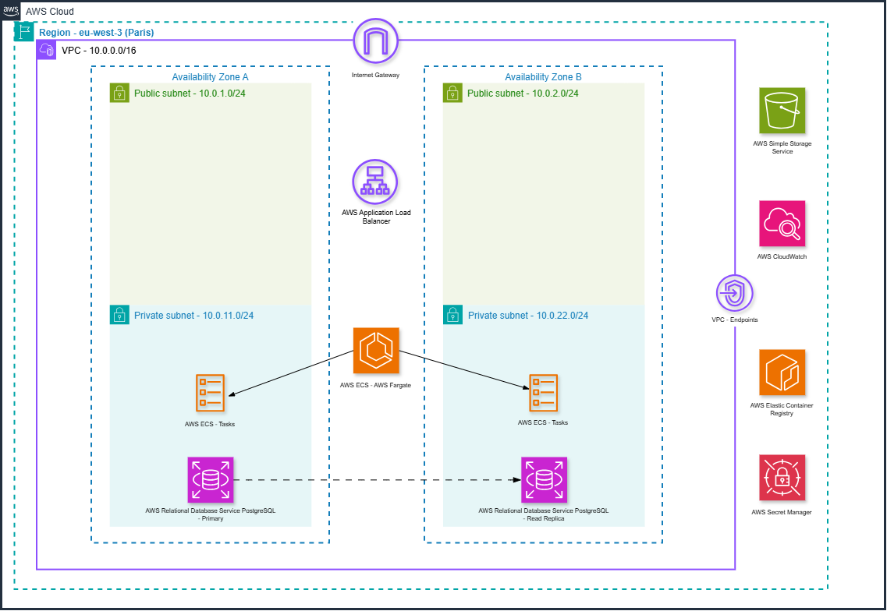
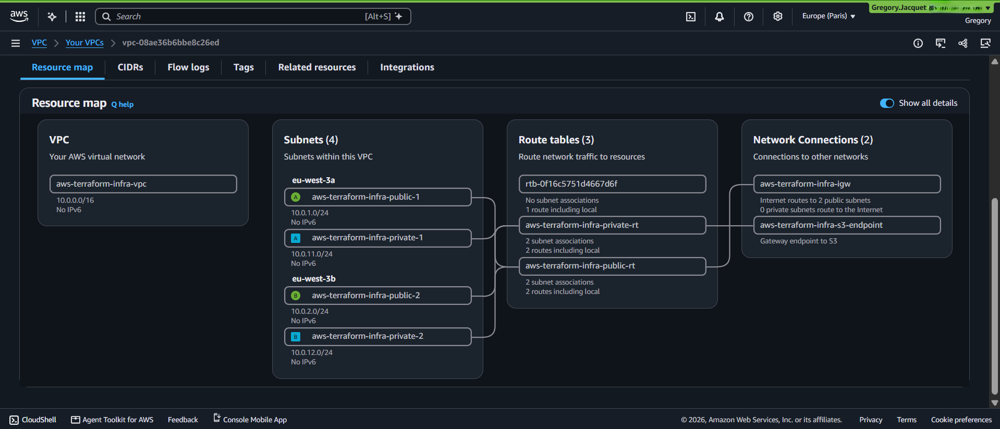
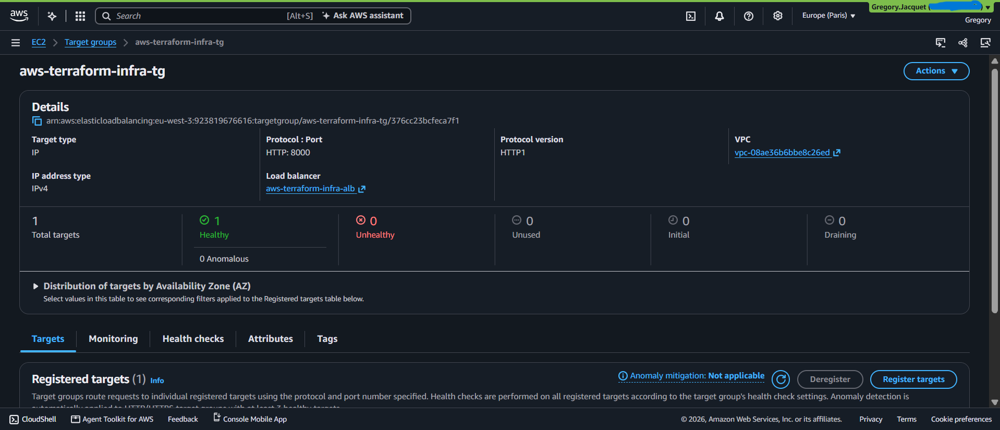
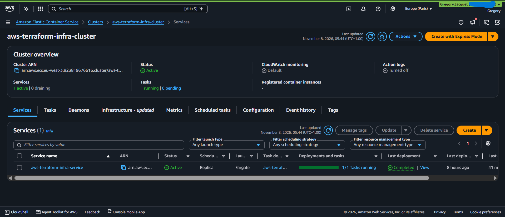
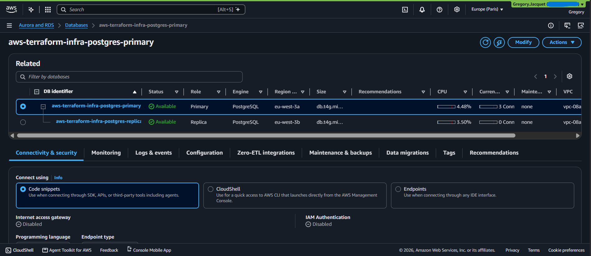
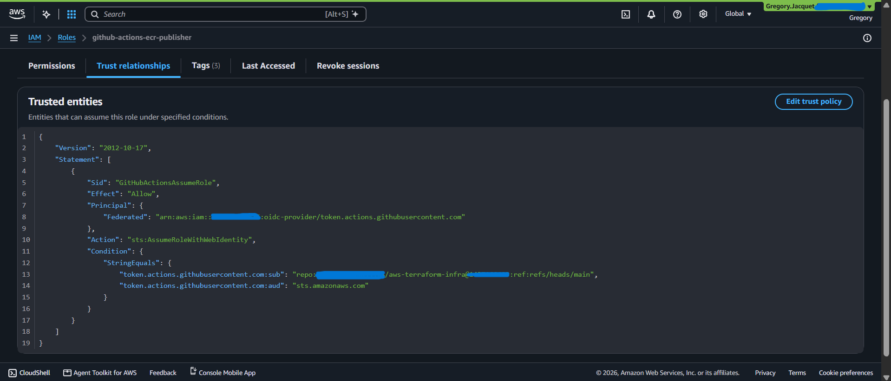
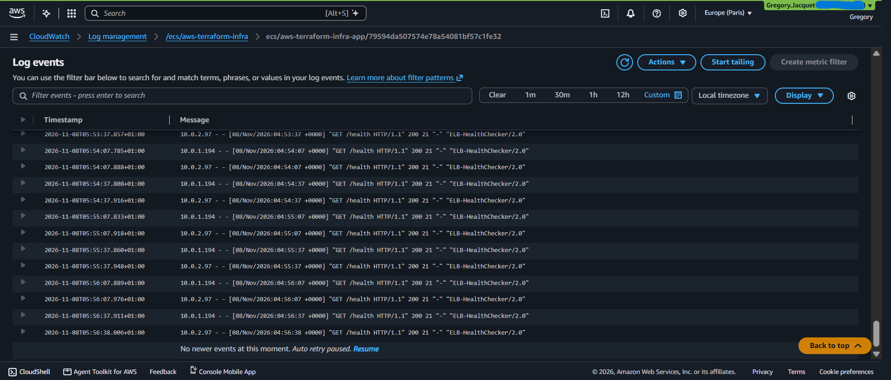
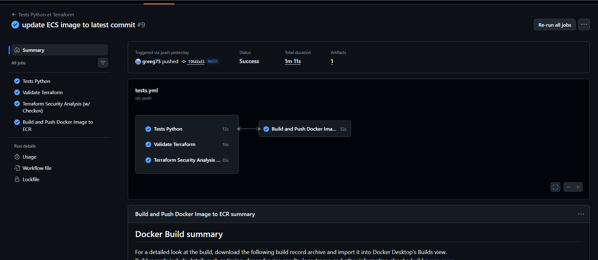
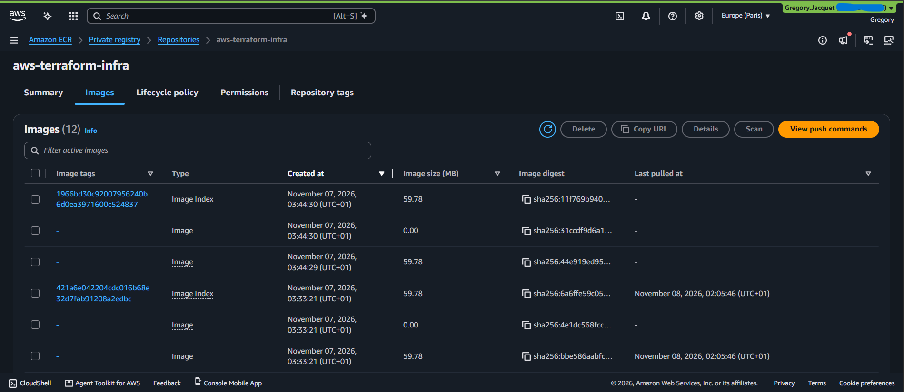
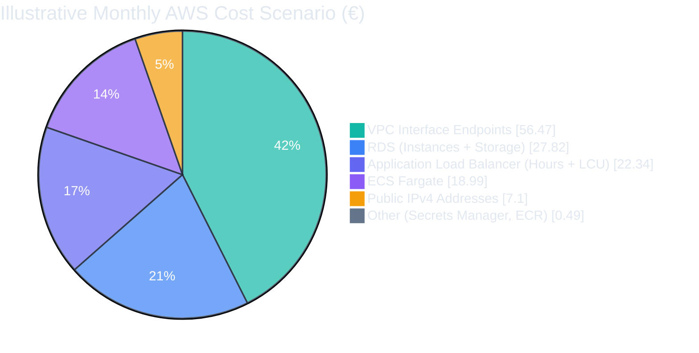

# AWS Terraform Infrastructure

> A containerized Flask application deployed on AWS with Terraform, Amazon ECS Fargate, Amazon RDS for PostgreSQL, private VPC connectivity, and GitHub Actions CI/CD.

## 📖 Table of Contents

- [Project Overview](#-project-overview)
- [Architecture Diagram](#-architecture-diagram)
- [Architecture Features](#-architecture-features)
- [Project Structure](#-project-structure)
- [Deployment Workflow](#deployment-workflow)
- [Application Endpoints](#application-endpoints)
- [Detailed Architecture Breakdown](#-detailed-architecture-breakdown)
  - [Network Architecture](#1-network-architecture--amazon-vpc)
  - [Application Load Balancer](#2-application-load-balancer-alb)
  - [ECS and AWS Fargate](#3-containerized-application--amazon-ecs--aws-fargate)
  - [RDS for PostgreSQL](#4-database-layer--amazon-rds-for-postgresql)
  - [VPC Endpoints](#5-private-connectivity--vpc-endpoints)
  - [Security Groups](#6-network-security--security-groups)
  - [IAM and GitHub OIDC](#7-identity--access-management--iam-and-github-oidc)
  - [Secrets Manager](#8-secrets-management--aws-secrets-manager)
  - [CloudWatch](#9-monitoring--logging--amazon-cloudwatch)
  - [GitHub Actions](#10-cicd-pipeline--github-actions)
  - [Terraform Backend and Lifecycle](#11-terraform-backend--infrastructure-lifecycle)
- [Cost Analysis & Optimization](#-cost-analysis--optimization)
- [Future Improvement Areas](#-future-improvement-areas)
- [Project Outcomes](#-project-outcomes)
- [References & Documentation](#-references--documentation)
- [Author](#-author)


## 🚀 Project Overview

This project demonstrates the design, deployment, and management of a containerized application infrastructure on **Amazon Web Services (AWS)** using **Terraform**.

The infrastructure was built around a custom VPC spanning multiple Availability Zones, with **Amazon ECS on AWS Fargate** to run the application, an **Application Load Balancer (ALB)** to handle incoming HTTPS traffic, and **Amazon RDS for PostgreSQL** to provide managed database services.

The project also integrates infrastructure automation and security practices, including **GitHub Actions, GitHub Actions OIDC authentication, IAM roles, AWS Secrets Manager, VPC Endpoints, and Amazon CloudWatch**.

The main objective was to gain hands-on experience in building a secure, scalable, and maintainable AWS environment while applying Infrastructure as Code (IaC), containerization, and DevSecOps principles.


## 🏗️ Architecture Diagram




## 🏗️ Architecture Features

- **Multi-AZ Network Architecture:** Custom Amazon VPC deployed across two Availability Zones, with public and private subnets to isolate network components and application workloads.
- **Internet-Facing Application Load Balancer:** An Application Load Balancer deployed across both public subnets to handle incoming HTTPS traffic and distribute requests to the application.
- **Containerized Application on ECS Fargate:** Amazon ECS runs the Flask application on AWS Fargate, with two desired tasks distributed across private subnets.
- **Managed PostgreSQL Database:** Amazon RDS for PostgreSQL deployed in private subnets, with a primary database instance and a read replica in a separate Availability Zone.
- **Private AWS Service Connectivity:** VPC Endpoints provide private connectivity to Amazon ECR, AWS Secrets Manager, Amazon CloudWatch Logs, and Amazon S3 without requiring a NAT Gateway.
- **Identity and Access Management:** IAM roles and policies follow least-privilege principles, including GitHub Actions OIDC authentication and dedicated ECS task execution permissions.
- **Infrastructure as Code:** Terraform manages the AWS infrastructure through reusable configuration files and a remote state backend.
- **Monitoring and Logging:** Amazon CloudWatch collects application logs to support operational visibility and troubleshooting.


## 📁 Project Structure

```text
aws-terraform-infra/
├── .github/workflows/       # GitHub Actions CI/CD workflow
├── app/                     # Flask application, Dockerfile and tests
├── docs/
│   ├── architecture/        # AWS architecture diagram
│   └── screenshots/         # Infrastructure and deployment screenshots
├── terraform/               # AWS infrastructure as Code (Terraform)
│   ├── *.tf                 # Infrastructure, networking, security and IAM
│   └── terraform.tfvars.example
├── .gitignore
├── compose.yaml             # Local Docker Compose configuration
└── README.md
```

## Deployment Workflow

The V1 infrastructure and application workflow involved the following steps:

**Infrastructure Provisioning:** Terraform was used to provision the AWS networking, security, compute, database, and supporting resources through reusable configuration files and a remote state backend.

**Container Build:** Docker was used to build the Flask application image.

**Image Publishing:** GitHub Actions authenticated with AWS through OIDC and published the container image to Amazon ECR.

**Application Execution:** Amazon ECS on AWS Fargate ran the containerized application and integrated it with the Application Load Balancer.

**Configuration & Monitoring:** AWS Secrets Manager was integrated into the ECS Task Definition through an ARN reference for the `DATABASE_URL` environment variable. However, the actual database connection string was maintained in the local `.env` file and was not populated in AWS Secrets Manager. Amazon CloudWatch was configured to collect container logs.

The GitHub Actions workflow automated application testing, Terraform validation, security scanning, and Docker image publishing. Infrastructure provisioning and ECS service updates were not automated by this workflow.


## Application Endpoints

The deployed Flask application exposes a small REST API:

| Endpoint | Purpose |
|---|---|
| `GET /health` | Health check used by the Application Load Balancer. |
| `GET /health/db` | Verifies connectivity to the PostgreSQL database. |
| `GET /messages` | Returns messages stored in the database. |
| `POST /messages` | Creates a new message in the database. |


##  Detailed Architecture Breakdown

>[!NOTE]
>The architecture described below refers to the Version 1 environment. The V1 AWS resources were decommissioned after the project phase; the Terraform configuration is retained as a reproducible blueprint for future deployments.


### 1. Network Architecture – Amazon VPC

The infrastructure is deployed within a custom Amazon VPC (`10.0.0.0/16`) in the AWS Paris region (`eu-west-3`), spanning two Availability Zones (`eu-west-3a` and `eu-west-3b`) to improve availability and provide network isolation.

The VPC is divided into four subnets:

- **Public Subnets:** Two subnets, one per Availability Zone, hosting the internet-facing Application Load Balancer.
- **Private Subnets:** Two subnets, one per Availability Zone, hosting the ECS Fargate application tasks and Amazon RDS database instances.

An Internet Gateway provides internet connectivity to the public subnets through a public route table. Private subnets use a separate route table without a default route to the internet.

No NAT Gateway is deployed. Instead, VPC Endpoints provide private connectivity to selected AWS services, reducing the need for public internet access from private workloads.





### 2. Application Load Balancer (ALB)

An internet-facing Application Load Balancer is deployed across both public subnets to distribute incoming application traffic to the ECS Fargate service.

The ALB is configured with two listeners:

- **HTTP (port 80):** Redirects incoming HTTP requests to HTTPS.
- **HTTPS (port 443):** Terminates TLS connections using an SSL/TLS certificate managed by AWS Certificate Manager (ACM).

After TLS termination, the ALB forwards requests to an ECS target group over HTTP on port `8000`, where the Flask application listens.

Health checks are configured to monitor the application through its `/health` endpoint, allowing the ALB to route traffic only to healthy targets.





### 3. Containerized Application – Amazon ECS & AWS Fargate

The Flask application is containerized using Docker and deployed through Amazon ECS with AWS Fargate, a serverless compute engine for containers.

The deployment consists of:

- **ECS Cluster:** Provides the logical grouping for the application service and its tasks.
- **Task Definition:** Defines the container configuration, including the Docker image stored in Amazon ECR, CPU and memory allocation, port mapping, logging, and secrets injection.
- **ECS Service:** Maintains the desired number of running tasks and integrates them with the Application Load Balancer.
- **Fargate Tasks:** Two tasks are configured to run across the private subnets, with a desired count of two. Each task runs one Flask container.

The tasks use private IP addresses and do not receive public IP addresses. They communicate with the ALB on port `8000` and access the PostgreSQL database through a dedicated security group.

The container also uses a read-only root filesystem to reduce the risk of unauthorized filesystem modifications.





### 4. Database Layer – Amazon RDS for PostgreSQL

Amazon RDS for PostgreSQL is used as the managed relational database service for the application.

The database architecture consists of:

- **Primary DB Instance:** Hosts the application database in a private subnet within the first Availability Zone.
- **Read Replica:** A separate read replica deployed in the private subnet of the second Availability Zone, using asynchronous replication from the primary instance.

Both instances use encrypted storage and are configured as non-publicly accessible. Access to PostgreSQL is restricted through security groups, allowing connections from the ECS Fargate tasks on port `5432`.

The read replica provides an additional read capacity option and can be promoted manually if needed. It is not an automatic Multi-AZ standby instance and does not provide automatic failover.





### 5. Private Connectivity – VPC Endpoints

VPC Endpoints enable private connectivity between resources inside the VPC and supported AWS services without requiring an Internet Gateway or NAT Gateway for this traffic.

The infrastructure uses two types of VPC Endpoints:

- **Interface Endpoints:**
  - Amazon ECR API
  - Amazon ECR Docker Registry (ECR DKR)
  - AWS Secrets Manager
  - Amazon CloudWatch Logs

  These endpoints create network interfaces with private IP addresses in the private subnets and use AWS PrivateLink.

- **Gateway Endpoint:**
  - Amazon S3

  The S3 Gateway Endpoint is associated with the private route table and provides private access to S3 without traversing a NAT Gateway or Internet Gateway.

This configuration allows ECS Fargate tasks to retrieve container images, access application secrets, and send logs to CloudWatch through private AWS network connectivity.


### 6. Network Security – Security Groups

Security Groups are used as stateful virtual firewalls to control inbound and outbound traffic between the different components of the infrastructure.

Dedicated Security Groups are configured for the following resources:

- **ALB Security Group:** Allows incoming HTTP (port `80`) and HTTPS (port `443`) traffic from the internet and permits forwarding traffic to the ECS application on port `8000`.
- **ECS Security Group:** Allows inbound application traffic only from the ALB Security Group on port `8000`. Outbound rules restrict access to the required AWS services and PostgreSQL database.
- **VPC Endpoints Security Group:** Allows HTTPS traffic on port `443` from ECS tasks.
- **RDS Security Group:** Allows PostgreSQL connections on port `5432` exclusively from the ECS Security Group.

Explicit ingress and egress rules are defined to restrict communication between resources and follow the principle of least privilege.

Security Groups are stateful, meaning response traffic for permitted connections is automatically allowed.


### 7. Identity & Access Management – IAM and GitHub OIDC

AWS Identity and Access Management (IAM) controls access to AWS resources through dedicated roles and policies.

The project uses separate IAM permissions for application execution and CI/CD automation:

- **ECS Task Execution Role:** Allows ECS to retrieve container images from Amazon ECR, send container logs to CloudWatch, and retrieve application secrets from AWS Secrets Manager.
- **GitHub Actions OIDC Integration:** Establishes trust between GitHub Actions and AWS using OpenID Connect (OIDC), allowing workflow jobs to obtain temporary AWS credentials without storing long-lived AWS access keys in GitHub Secrets.
- **GitHub Actions IAM Role:** Grants the workflow the permissions required to authenticate with Amazon ECR and push container images to the repository.

IAM trust policies and permission policies restrict which identities can assume roles and which AWS actions they can perform, following the principle of least privilege.





### 8. Secrets Management – AWS Secrets Manager

Terraform creates an AWS Secrets Manager secret resource and configures the ECS task definition to reference its ARN for the DATABASE_URL environment variable.

For local development, the database connection string is stored in the local .env file and passed to the Flask container through Docker Compose. This local file is not available to ECS.

For an AWS deployment, the DATABASE_URL value must be populated separately in AWS Secrets Manager before the ECS service is started. The ECS task execution role is granted permission to retrieve this specific secret and inject it as an environment variable into the container.

The Secrets Manager VPC Endpoint enables this retrieval through private connectivity, without requiring a NAT Gateway.


### 9. Monitoring & Logging – Amazon CloudWatch

Amazon CloudWatch is used to collect and centralize application logs, providing visibility into the behavior of the containerized application.

The ECS task definition is configured with the AWS Logs driver to forward container logs to a dedicated CloudWatch Log Group.

CloudWatch Logs helps monitor application activity, investigate errors, and troubleshoot issues during runtime.

Log delivery is performed through the CloudWatch Logs VPC Endpoint, allowing private connectivity from the ECS tasks without requiring a NAT Gateway.





### 10. CI/CD Pipeline – GitHub Actions

GitHub Actions is used to automate application testing, Terraform validation, security scanning, and Docker image publishing.

The CI/CD workflow consists of four main jobs:

- **Automated Testing:** Installs application dependencies and runs unit tests using `pytest`.
- **Terraform Validation:** Checks Terraform formatting and validates the infrastructure configuration.
- **Security Scanning:** Uses Checkov to scan Terraform files for potential security and configuration issues.
- **Docker Build & Publish:** Builds the application container image and pushes it to Amazon ECR.

The workflow uses GitHub Actions OIDC to authenticate with AWS through temporary credentials, avoiding the need to store long-lived AWS access keys in GitHub Secrets.

The image publishing job runs after the previous jobs succeed, only on the `main` branch, and only when the repository variable `PUBLISH_IMAGE` is set to `true`. Since the V1 infrastructure (including the OIDC role and the ECR repository) was decommissioned, this variable is set to `false` and the job is skipped.






### 11. Terraform Backend & Infrastructure Lifecycle

Terraform is configured to use an Amazon S3 remote backend for the state file, providing centralized state management across deployments.

The repository backend configuration specifies:

**S3 remote state:** The state is stored in an S3 bucket in eu-west-3.

**Server-side encryption:** Terraform requests encrypted state storage through `encrypt = true`.

**S3 lockfile:** Terraform uses use_lockfile = true to help prevent concurrent state modifications.

The backend bucket used during the V1 deployment was decommissioned following the infrastructure cleanup. Before a future deployment, the bucket must be recreated and the backend configuration must be initialized again.

>[!IMPORTANT]
>Bucket-level controls such as versioning and Public Access Block are not provisioned by the Terraform configuration in this repository. They must be configured separately, or added to a dedicated bootstrap Terraform configuration.


## 💰 Cost Analysis & Optimization

> [!NOTE]
> This section presents an illustrative monthly cost scenario for the **Version 1** AWS architecture running continuously in **Europe (Paris) — `eu-west-3`**.
>
> The figures are approximate and were not generated with AWS Pricing Calculator or derived from AWS billing data. They are intended to highlight the main cost drivers of the architecture, based on 24/7 operation and a 30-day month (720 hours).

### At a Glance

| Illustrative monthly scenario |
|:---:|
| **€133.21** |

### Illustrative Monthly Cost Scenario

| AWS Service | Configuration | Illustrative Monthly Cost | Share |
|---|---|---:|---:|
| VPC Interface Endpoints | 4 endpoints across 2 Availability Zones | €56.47 | 42.4% |
| Amazon RDS | 2 × `db.t4g.micro` instances | €23.10 | 17.3% |
| Amazon ECS Fargate | 2 tasks, 0.25 vCPU and 0.5 GB each | €18.99 | 14.3% |
| Application Load Balancer | 720 operating hours | €16.95 | 12.7% |
| Public IPv4 Addresses | Assumption: 2 addresses | €7.10 | 5.3% |
| ALB Capacity Units | Assumption: 1 average LCU | €5.39 | 4.0% |
| RDS Storage | 20 GB primary + 20 GB read replica | €4.72 | 3.5% |
| AWS Secrets Manager | 1 configured secret | €0.39 | 0.3% |
| Amazon ECR | Assumption: 1 GB of stored images | €0.10 | 0.1% |
| Amazon CloudWatch | Assumption: usage within the applicable free allowance | €0.00 | 0.0% |
| **Total** |  | **€133.21** | **100%** |

> [!TIP]
> In this illustrative scenario, VPC Interface Endpoints are the largest cost driver, accounting for approximately **42%** of the estimated monthly total.

### Illustrative Monthly Cost Distribution

> [!NOTE]
> This chart visualizes the illustrative scenario above. It does not represent actual AWS billing data.



### Cost Optimization Considerations

| Decision | Impact |
|---|---|
| **No NAT Gateway** | Private subnets reach selected AWS services through VPC Endpoints, avoiding NAT Gateway hourly and data-processing charges. |
| **S3 Gateway Endpoint** | Private access to Amazon S3 with no endpoint hourly charge. |
| **ECR Lifecycle Policy** | Keeps the latest 10 tagged images and removes untagged images after 7 days. |
| **CloudWatch Log Retention** | Application logs are retained for 30 days. |
| **Infrastructure Cleanup** | The V1 infrastructure was destroyed after the project phase to avoid ongoing charges. |

### Important Assumptions

> [!WARNING]
> These amounts are illustrative only, not AWS billing data or a quote produced by AWS Pricing Calculator. Actual costs may differ significantly depending on AWS pricing changes, traffic, data processing, task runtime, database activity, log ingestion, storage volume, and deployed architecture.

- Estimates exclude applicable taxes, domain registration, data-transfer charges, and other usage-based charges not explicitly quantified.
- The VPC Interface Endpoint estimate represents four interface endpoint services deployed across two Availability Zones. Data-processing charges are not included.
- The Public IPv4 and ALB Capacity Unit figures are assumptions for this scenario.
- The CloudWatch estimate assumes log usage remains within the applicable free allowance.
- The V1 infrastructure was decommissioned after the project phase; these figures describe a hypothetical continuous-operation scenario, not current running costs.


## 🚀 Future Improvement Areas

Version 1 established a secure foundation for the infrastructure. The following improvements are planned for a future version of the project.

| Area                              | Improvement                                                                                                                                                                           | Expected Benefit                                                                                  |
| --------------------------------- | ------------------------------------------------------------------------------------------------------------------------------------------------------------------------------------- | ------------------------------------------------------------------------------------------------- |
| **Terraform backend**             | Create a dedicated bootstrap configuration to provision and secure the S3 state bucket, including versioning and Public Access Block.                                                 | Makes backend setup reproducible and removes manual configuration steps.                          |
| **Terraform modularization**  | Refactor the current flat Terraform configuration into reusable modules for networking, security, ECS, RDS, ECR, and observability, with clearly defined variables and outputs. | Improves maintainability, readability, reuse across environments, and makes future changes safer. |
| **Secrets management**            | Define a secure process to populate and rotate `DATABASE_URL` in AWS Secrets Manager without committing sensitive values to the repository or Terraform state.                        | Strengthens the lifecycle management of application credentials.                                  |
| **Continuous deployment**         | Extend GitHub Actions to update the ECS service after a successful ECR image publication, with an approval step for production deployments.                                           | Automates application delivery while retaining deployment control.                                |
| **Observability**                 | Add CloudWatch alarms, dashboards, ECS Container Insights, and operational notifications.                                                                                             | Improves visibility into availability, performance, and failures.                                 |
| **High availability and scaling** | Add ECS Service Auto Scaling and evaluate an RDS Multi-AZ deployment for automatic database failover.                                                                                 | Improves resilience and adapts capacity to demand.                                                |
| **Security hardening**            | Evaluate AWS WAF for the public ALB, ALB access logs, VPC Flow Logs, secret rotation, and customer-managed KMS keys where appropriate.                                                | Provides stronger protection, auditing, and operational traceability.                             |
| **Cost optimization**             | Reassess the Interface Endpoint architecture against workload traffic and compare it with NAT Gateway alternatives where relevant.                                                    | Helps balance private connectivity requirements against operating costs.                          |

> [!NOTE]
> These improvements are intentionally planned for a future version. They were not implemented in Version 1 in order to keep the initial project focused, understandable, and cost-conscious.


## 🎯 Project Outcomes

This project provided hands-on experience in designing, deploying, and managing a containerized application infrastructure on AWS.

The main outcomes include:

- **Infrastructure as Code:** Designed, structured, validated, and provisioned AWS infrastructure with Terraform (networking, compute, database, and security), using an S3 remote state backend.
- **Cloud Networking:** Implemented a multi-AZ VPC with public and private subnets, controlled routing, Security Groups, and VPC Endpoints as an alternative to a NAT Gateway.
- **Cloud Security:** Applied IAM least-privilege principles, GitHub Actions OIDC federation (no long-lived AWS keys), private service connectivity, and AWS Secrets Manager integration with the ECS task definition (the secret value is provisioned separately).
- **Containerization & Orchestration:** Packaged a Flask application with Docker and deployed it on Amazon ECS with AWS Fargate behind an Application Load Balancer.
- **CI/CD Automation:** Built a GitHub Actions workflow for automated testing, Terraform validation, security scanning with Checkov, and opt-in Docker image publishing to Amazon ECR.
- **Monitoring & Troubleshooting:** Used CloudWatch Logs and ALB health checks to investigate application behavior.
- **Lifecycle & Cost Management:** Practiced infrastructure provisioning and cleanup, identified the main cost drivers (VPC Interface Endpoints), and destroyed the environment to avoid ongoing charges.

The project strengthened my understanding of how cloud infrastructure, application deployment, networking, security, and automation work together within an AWS environment.


## 📚 References & Documentation

- [AWS Documentation](https://docs.aws.amazon.com/)
- [AWS Well-Architected Framework](https://docs.aws.amazon.com/wellarchitected/latest/framework/welcome.html)
- [AWS VPC Documentation](https://docs.aws.amazon.com/vpc/latest/userguide/what-is-amazon-vpc.html)
- [Terraform AWS Provider Documentation](https://registry.terraform.io/providers/hashicorp/aws/latest/docs)
- [Amazon ECS Documentation](https://docs.aws.amazon.com/AmazonECS/latest/developerguide/Welcome.html)
- [AWS IAM Documentation](https://docs.aws.amazon.com/IAM/latest/UserGuide/introduction.html)
- [GitHub Actions Documentation](https://docs.github.com/en/actions)
- [GitHub Actions OIDC with AWS](https://docs.github.com/en/actions/how-tos/secure-your-work/security-harden-deployments/oidc-in-aws)
- [Docker Documentation](https://docs.docker.com/)


## 📝 Final Note

This project represents an important step in my journey toward Cloud Engineering, DevOps, and Cloud Security.

Beyond the code, it represents my transition from manual infrastructure management to **Infrastructure as Code (IaC)**.

In modern cloud environments, the ability to provision consistent, reproducible, and maintainable infrastructure through automation provides significant operational advantages.

Through this project, I explored how to:

1. **Standardize** infrastructure deployments through version-controlled Terraform configurations, reducing the risk of configuration inconsistencies.
2. **Automate** infrastructure provisioning and application delivery workflows, reducing repetitive manual operations.
3. **Secure** cloud environments through IAM permissions, OIDC authentication, network isolation, and repeatable security configurations.
4. **Improve operational efficiency** by combining infrastructure automation, containerization, monitoring, and cost awareness.

Overall, this project reflects an automation-first mindset focused on reliability, security, scalability, and operational efficiency in cloud environments.

Version 1 established the technical foundation for future improvements, with a second version planned to further enhance automation, security, monitoring, and cost optimization.


## 👤 Author

**Grégory JACQUET**

Aspiring Cloud Security Engineer

**AWS Certifications:**
- AWS Certified Solutions Architect – Associate (SAA-C03)
- AWS Certified Cloud Practitioner (CLF-C02)

**Professional Profiles:**
- **LinkedIn:** [Gregory Jacquet](https://www.linkedin.com/in/gregoryjacquet/)
- **GitHub:** [greeg75](https://github.com/greeg75)

This project was independently designed and implemented as part of my journey toward Cloud Engineering, DevOps, and Cloud Security.


